# RAON - 웹소설 연재·감상 플랫폼

[](https://github.com/ryushin01/RAON-Monorepo/actions/workflows/ci.yml)


작가는 에디터로 작품을 연재하고, 독자는 회차나 작품을 코인으로 구매해 뷰어에서 읽는 웹소설 플랫폼의 모노레포입니다. **라온**은 ‘즐거운’을 뜻하는 우리말입니다.

> **프로젝트 상태:** 포트폴리오 프로젝트입니다. 데모 사이트 없이 [로컬에서 실행](#시작하기)합니다. 결제는 실제 돈이 오가지 않는 가상 충전이고, 화면의 작품·작가·회원은 모두 가상 데이터입니다.

## 화면

화면의 작품, 작가, 본문은 이 프로젝트를 위해 지어낸 시드 데이터입니다.

| 홈                                                                                  | 작품 목록                                                           |
| ----------------------------------------------------------------------------------- | ------------------------------------------------------------------- |
| 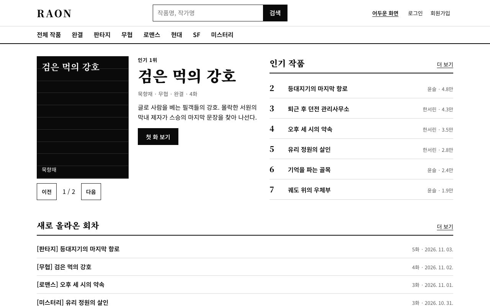 | 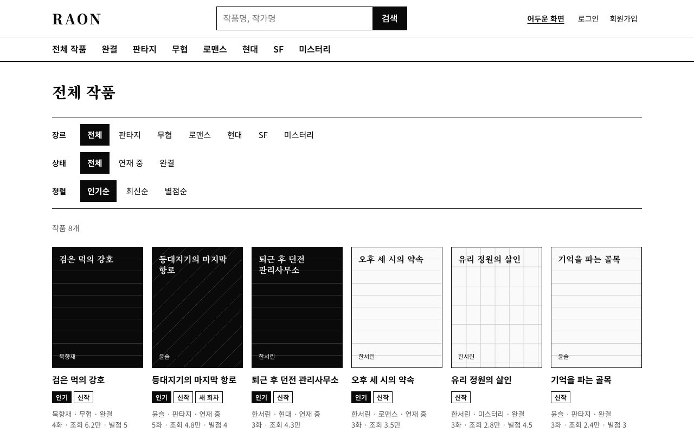 |

| 작품 상세                                                                           | 장바구니                                                                       |
| ----------------------------------------------------------------------------------- | ------------------------------------------------------------------------------ |
| 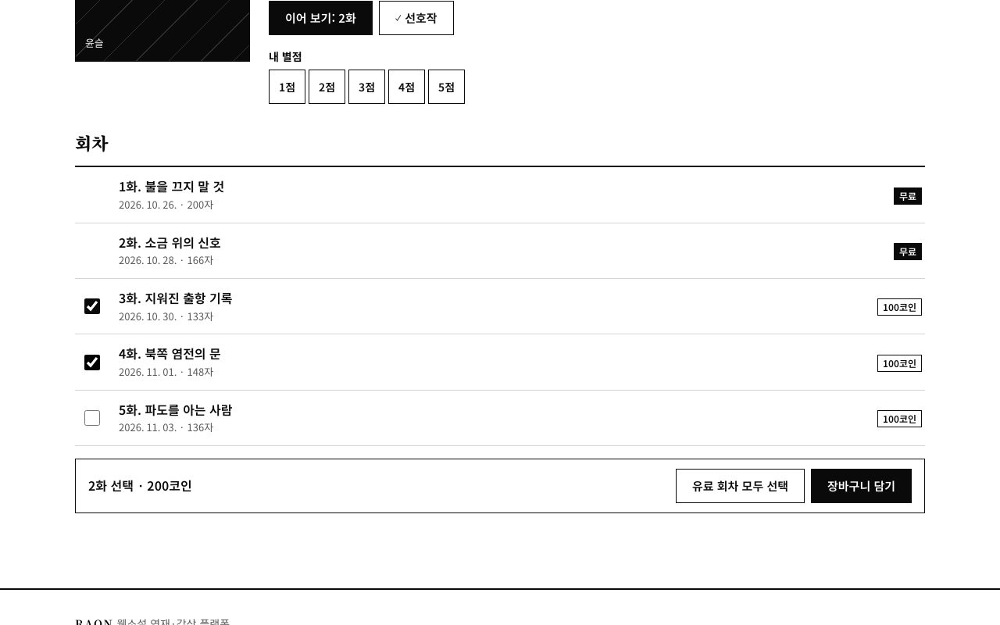 | 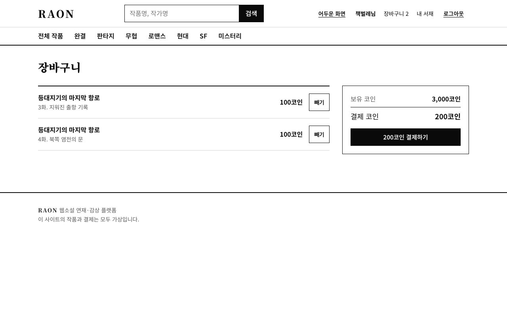 |

| 뷰어                                                    | 뷰어 보기 설정                                                                                  |
| ------------------------------------------------------- | ----------------------------------------------------------------------------------------------- |
| 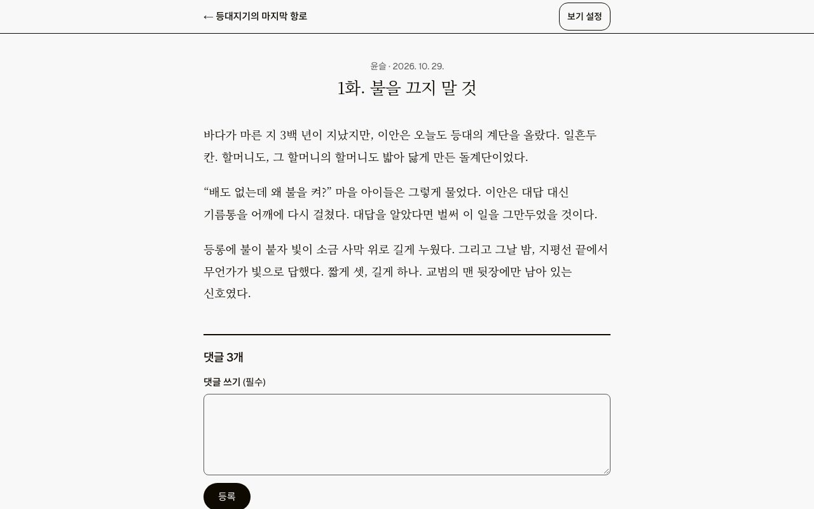 | 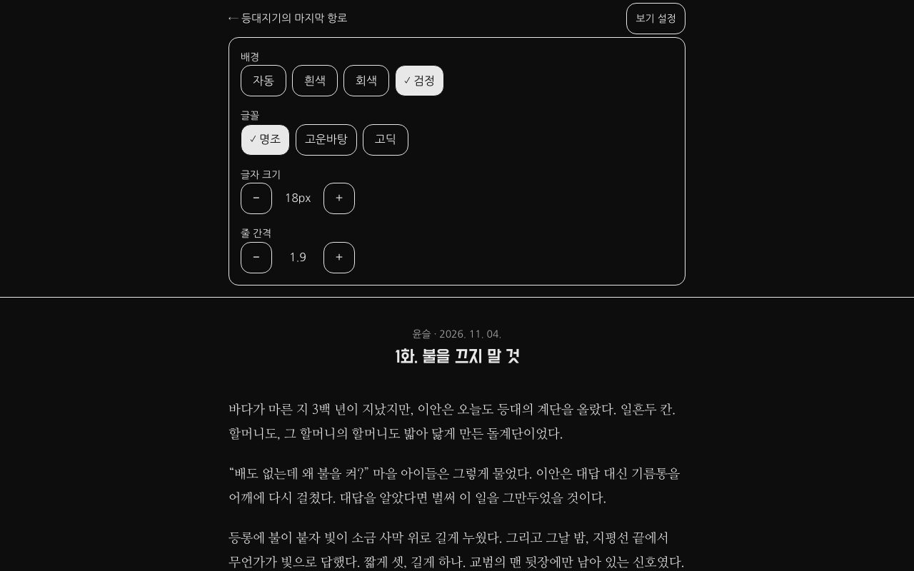 |

| 작가 스튜디오                                                   | 회차 에디터                                                                 |
| --------------------------------------------------------------- | --------------------------------------------------------------------------- |
| 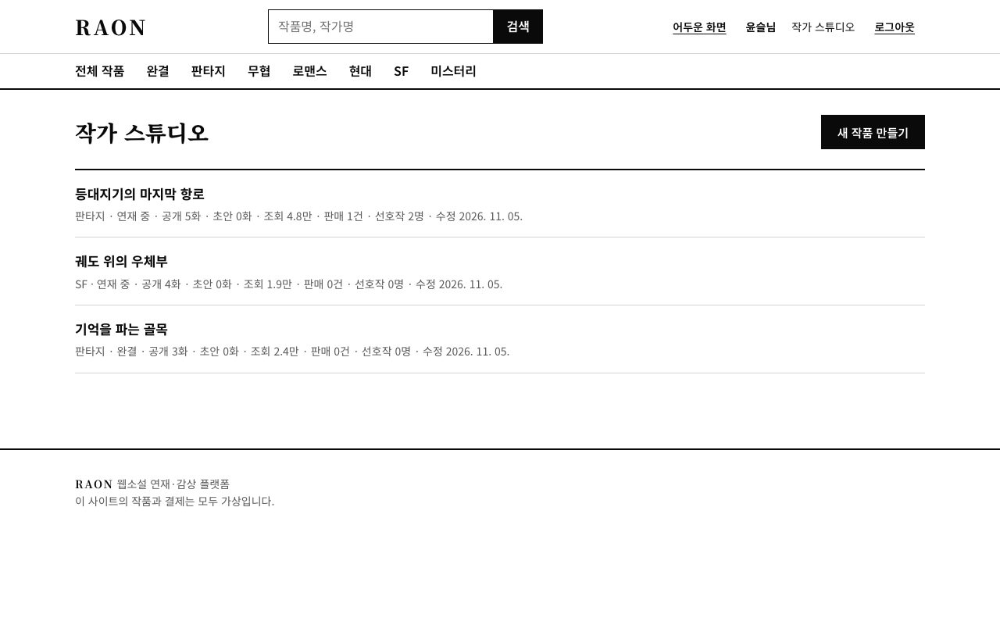 | 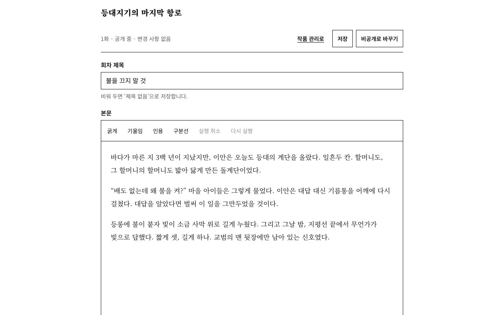 |

| 내 서재                                                                   | 회차 댓글                                                                |
| ------------------------------------------------------------------------- | ------------------------------------------------------------------------ |
| 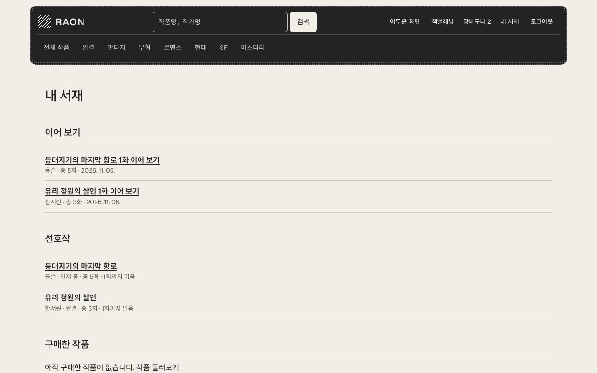 | 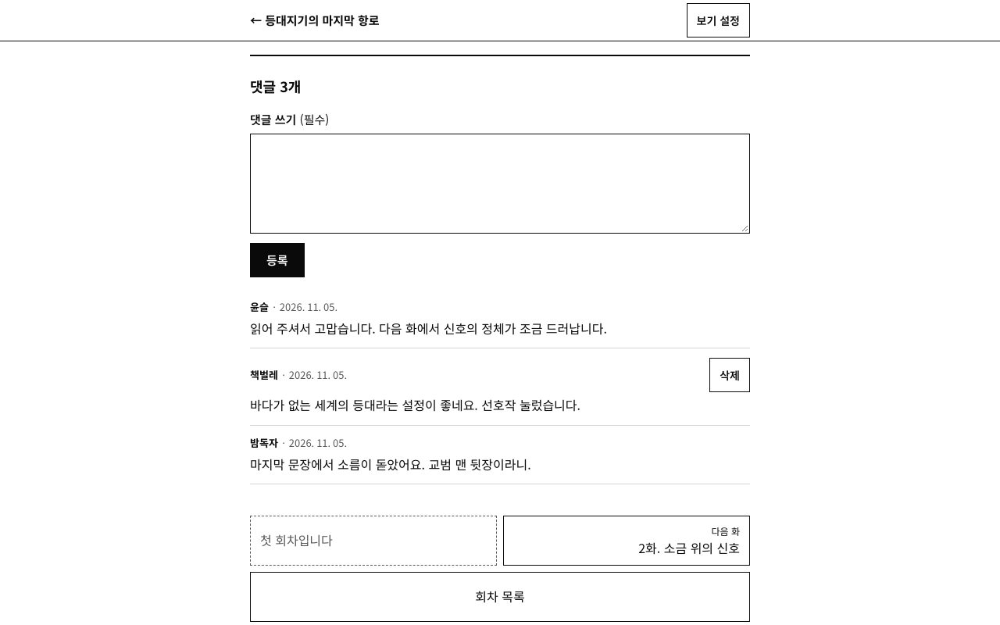 |

| 모바일 홈                                                                                  | 모바일 유료 회차                                                                                           |
| ------------------------------------------------------------------------------------------ | ---------------------------------------------------------------------------------------------------------- |
| 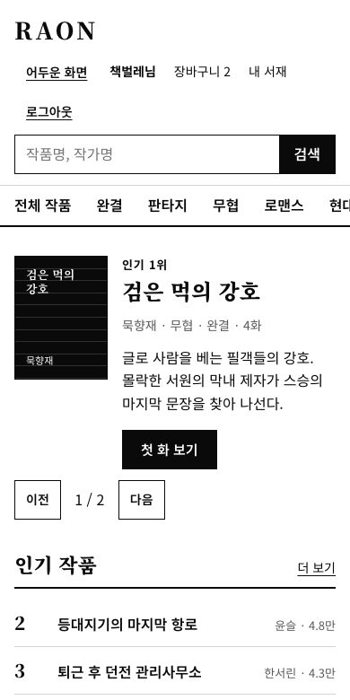 | 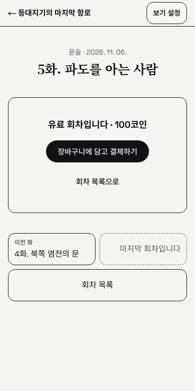 |

## 주요 기능

| 사용자    | 기능                                                                                                                                             |
| --------- | ------------------------------------------------------------------------------------------------------------------------------------------------ |
| 공통      | 일반 회원·작가 구분 가입과 로그인, 작품 검색, 장르·상태·태그 필터, 인기·최신·별점 정렬, 메인 배너, 뱃지, 흑백 밝은·어두운 화면                   |
| 일반 회원 | 무료 회차 감상, 회차 또는 완결 작품 전체를 담아 코인 결제(이미 산 회차는 차감), 가상 충전, 내 서재, 선호작, 이어 보기, 회차 댓글, 별점           |
| 뷰어      | 배경, 글꼴, 글자 크기, 줄 간격 설정 유지, 앞뒤 회차 이동, 권한 없는 유료 본문 차단                                                               |
| 작가      | 작품 관리, 표지 업로드, 태그, 회차 에디터(서식, 초안 자동 저장, 원고 백업·복원), 공개·예약 공개, 회차 순서 변경, 삭제, 완결 처리, 판매·선호작 수 |

## 기술 스택


| 구분             | 사용 기술                                                                                                                     |
| ---------------- | ----------------------------------------------------------------------------------------------------------------------------- |
| 모노레포         | Yarn 4 workspaces, Turborepo                                                                                                  |
| 웹 (`apps/web`)  | Next.js 16(App Router, Turbopack, `use cache`, Server Actions), React 19.2(Compiler), TanStack Query, Sass, Tiptap, js-cookie |
| API (`apps/api`) | NestJS 12, Drizzle ORM, PostgreSQL(개발·테스트는 PGlite), JWT                                                                 |
| 언어             | TypeScript 7(타입 검사), TypeScript 6(도구용)                                                                                 |
| 품질             | Biome, Stylelint, Jest, Playwright, axe, Storybook, CodeRabbit, GitHub Actions                                                |

## 시작하기

Node.js 24 이상과 yarn이 필요합니다. 저장소의 Yarn 4가 자동으로 쓰입니다. DB 설치 없이 PGlite와 시드 데이터로 바로 실행됩니다.

```bash
yarn install
yarn dev        # 웹 http://localhost:3100, API http://localhost:4000
```

개발용 계정의 비밀번호는 모두 `raon1234`입니다.

| 유형      | 이메일             |
| --------- | ------------------ |
| 일반 회원 | `reader@raon.test` |
| 작가      | `author@raon.test` |

| 명령                           | 내용                                              |
| ------------------------------ | ------------------------------------------------- |
| `yarn lint` / `yarn typecheck` | Biome 검사, TypeScript 7 타입 검사                |
| `yarn test`                    | 단위·API 통합 테스트(Jest)                        |
| `yarn build`                   | 프로덕션 빌드                                     |
| `yarn e2e`                     | 프로덕션 빌드 기준 E2E(사용자 흐름, 접근성, 넘침) |
| `yarn storybook`               | Storybook 실행                                    |
| `yarn screenshots`             | README 스크린샷 다시 찍기                         |

## 프로젝트 구조

```text
apps/
  web/          Next.js 앱. src는 Feature-Sliced Design(_app, _pages, widgets, features, entities, shared)
  api/          NestJS API. 인증, 카탈로그, 장바구니·결제, 스튜디오 모듈과 DB 스키마
packages/
  contracts/    웹과 API가 함께 쓰는 zod 스키마와 응답 타입
  config/       공용 tsconfig, TypeScript 7 실행 도구(tsc7)
```

## 문서

| 문서                                        | 내용                                             |
| ------------------------------------------- | ------------------------------------------------ |
| [개발 가이드](docs/development.md)          | 구조와 규칙, 데이터 흐름, 스키마 변경 방법       |
| [CI·배포](docs/deployment.md)               | CI 단계, 도커 이미지, 환경 변수, CodeRabbit 설정 |
| [접근성·표준 점검표](docs/accessibility.md) | KWCAG 2.2 33개 항목 대조 결과와 숨겨진 화면 규칙 |
| [버전 기록](CHANGELOG.md)                   | 버전별 변경 내용                                 |

## 향후 과제

- 실제 결제(PG) 연동, 환불, 작가 정산
- 비밀번호 재설정, 이메일 인증, 회원 탈퇴
- 관리자 화면, 약관·개인정보 처리방침, 연령 등급
