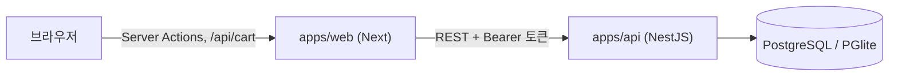

# 개발 가이드

## 데이터 흐름



- 브라우저는 API를 직접 부르지 않습니다. 로그인 토큰은 Next가 httpOnly 쿠키로 보관하고, 서버에서 API를 부를 때 붙입니다.
- 권한은 API가 최종 판단합니다. Next의 `proxy.ts`와 `requireUser`는 화면 이동만 담당합니다.
- 입력 검증과 응답 타입은 `@raon/contracts` 하나로 맞춥니다.

## 캐시 규칙

- `use cache`는 공개 정보(`entities/work/api/queries.ts`의 작품 목록, 상세)에만 씁니다. 작가가 내용을 바꾸면 Server Action이 `updateTag("works")`로 비웁니다.
- 유료 본문, 초안, 사용자별 구매 정보는 캐시하지 않습니다.
- 페이지의 데이터는 `Suspense` 안에서 요청 시점에 읽으므로 `next build`에 API가 필요 없습니다.

## 웹 구조 (Feature-Sliced Design)

- 계층: `_app` → `_pages` → `widgets` → `features` → `entities` → `shared`. 아래 계층만 가져옵니다(Biome `noRestrictedImports`로 검사).
- Next의 `src/app` 라우트 파일은 `_app`, `_pages`를 다시 내보내기만 합니다.
- 오류 화면: `error.tsx`와 `not-found.tsx`는 `_pages/errors`를, 루트 레이아웃까지 실패할 때의 `global-error.tsx`는 `_app/layouts/global-error-layout`을 내보냅니다. `global-error`에는 웹폰트와 저장된 테마가 적용되지 않습니다.
- 슬라이스는 `index.ts`로만 가져오고, 서버 전용 코드는 `index.server.ts`로 내보냅니다.
- 스타일은 Sass CSS Modules입니다. 색은 `_app/styles/global.scss`의 CSS 변수(흑백)만 씁니다.
- 컴포넌트 옆에 스토리와 테스트를 둡니다. 서버에서 데이터를 읽는 async 페이지(`home`, `works`, `work-detail`, `viewer`, `cart`, `my`, `studio-*`)와 `UserMenu`는 Storybook과 Jest에서 그릴 수 없어 E2E로 검사합니다.
- 저장 요청은 `useMutation`의 `mutate(data)`로 데이터를 직접 넘기고, `isPending`으로 중복 제출을 막습니다.

## 구매 규칙

- 가격은 서버가 현재 값으로 계산합니다. 작품 전체 구매는 완결 작품에서만 팔고, 앞으로 추가되는 회차까지 포함합니다. 이미 산 회차에 쓴 코인은 작품 가격에서 뺍니다.
- 결제는 사용자 행을 잠근 트랜잭션에서 처리하고, 멱등 키로 중복 결제를 막습니다.
- 판매한 회차는 비공개로 돌리거나 지울 수 없습니다. 작품 전체를 산 사람이 있으면 공개한 모든 회차가 판매한 것입니다.
- 코인 충전(`CommerceService.charge`)은 가상입니다. PG를 붙일 때 결제 승인 뒤에 호출하도록 바꿉니다.

## 회차 본문

본문은 HTML이 아니라 문서 JSON으로 저장합니다. 허용하는 노드와 마크는 세 곳이 함께 맞아야 합니다.

1. `packages/contracts/src/document.ts`: API 검증 스키마
2. `apps/web/src/features/episode-editor/ui/extensions.ts`: 에디터
3. `apps/web/src/entities/episode/ui/episode-content.tsx`: 뷰어

## DB 스키마 변경

`apps/api/src/db/schema.ts`를 고친 뒤 마이그레이션을 만들고 함께 커밋합니다. API가 시작할 때 자동으로 적용합니다.

```bash
yarn workspace @raon/api db:generate
yarn workspace @raon/api db:reset   # 개발 DB를 지우고 다음 실행 때 시드로 다시 만듭니다.
```

## 조회수

서버 렌더링마다 세면 새로고침이나 댓글 등록만으로 늘어나므로, 뷰어 화면이 탭 하나에 회차당 한 번 기록 요청을 보냅니다(`features/episode-view`). 작가 본인과 읽을 수 없는 회차는 세지 않습니다.

## 예약 공개와 뱃지

- 예약 회차는 `status = PUBLISHED`이고 `published_at`이 미래입니다. 독자용 쿼리는 모두 공개 시각이 지났는지까지 확인합니다. 작품 목록과 상세는 캐시하므로 시각이 지나도 몇 분 늦게 보일 수 있습니다. 보이는 회차가 없는 작품은 독자에게 없는 작품으로 다루고 팔지 않습니다. 예약 시각은 한국 시간으로 입력합니다.
- 뱃지는 API가 계산합니다. 인기는 조회 30,000 이상, 신작은 첫 공개 14일 이내, 새 회차는 최근 공개 3일 이내입니다.

## 표지와 쿠키

- 표지는 파일 서버 없이 실행되도록 DB(`work_covers`)에 둡니다. 파일 이름이나 Content-Type이 아니라 내용으로 JPG, PNG, WebP를 판별하고, SVG는 받지 않습니다. 브라우저는 `/api/covers/[workId]`를 통해 받습니다.
- 테마와 뷰어 설정은 js-cookie로 쿠키에 저장합니다(`shared/lib/preferences.ts`). 첫 화면 전에 적용하는 인라인 스크립트(`PREFERENCES_SCRIPT`)도 같은 쿠키를 읽습니다.
- 세션 토큰은 httpOnly 쿠키로만 다루고, 원고 백업은 크기 때문에 `localStorage`에 둡니다.

## 회차 원고 보호

- 초안은 입력이 멈추면 자동 저장하고, 실패하면 15초 뒤 다시 시도합니다. 화면을 떠날 때 남은 변경 사항도 저장합니다.
- 공개한 회차는 독자에게 바로 보이므로 저장 버튼으로만 반영합니다.
- 화면을 숨겼다 돌아오면 서버에서 최신 회차를 읽어 에디터를 새로 시작합니다.
- 저장하지 못한 입력은 브라우저(`localStorage`)에 백업하고, 다시 열면 서버 내용과 다를 때 복원을 제안합니다. 복원 여부를 고르기 전에는 백업을 덮어쓰거나 지우지 않고, 로그아웃할 때 모두 지웁니다.

## 표준과 접근성

KWCAG 대조 결과와 Next의 숨겨진 화면 때문에 지켜야 할 규칙은 [접근성·표준 점검표](accessibility.md)에 있습니다.

## 완료 기준

```bash
yarn lint && yarn typecheck && yarn test && yarn build && yarn build-storybook && yarn e2e
```
