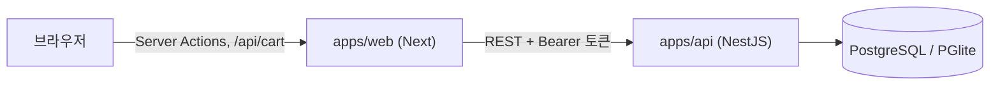

# 개발 가이드

## 데이터 흐름



- 브라우저는 API를 직접 부르지 않습니다. 로그인 토큰은 Next가 httpOnly 쿠키로 보관하고, 서버에서 API를 부를 때 붙입니다.
- 권한은 API가 최종 판단합니다. Next의 `proxy.ts`와 `requireUser`는 화면 이동만 담당합니다.
- 입력 검증과 응답 타입은 `@raon/contracts` 하나로 맞춥니다.

## 캐시 규칙

- `use cache`는 공개 정보(`entities/work/api/queries.ts`의 작품 목록, 상세)에만 씁니다. 작가가 내용을 바꾸면 Server Action이 `updateTag("works")`로 비웁니다.
- 유료 본문, 초안, 사용자별 구매 정보는 캐시하지 않습니다.
- 페이지의 데이터는 `Suspense` 안에서 요청 시점에 읽으므로 `next build`에 API가 필요 없습니다.

## 웹 구조 (Feature-Sliced Design)

- 계층: `_app` → `_pages` → `widgets` → `features` → `entities` → `shared`. 아래 계층만 가져옵니다(Biome `noRestrictedImports`로 검사).
- Next의 `src/app` 라우트 파일은 `_app`, `_pages`를 다시 내보내기만 합니다.
- 오류 화면: `error.tsx`와 `not-found.tsx`는 `_pages/errors`를, 루트 레이아웃까지 실패할 때의 `global-error.tsx`는 `_app/layouts/global-error-layout`을 내보냅니다. `global-error`에는 웹폰트와 저장된 테마가 적용되지 않습니다.
- 슬라이스는 `index.ts`로만 가져오고, 서버 전용 코드는 `index.server.ts`로 내보냅니다.
- 스타일은 Sass CSS Modules입니다. 색은 `_app/styles/global.scss`의 CSS 변수만 씁니다. 오프화이트·차콜 무채색이 기본이고, `--panel-*`은 테마와 상관없이 어두운 판(머리글, 푸터, 에디터 도구 모음)에 씁니다. 판 안에서는 `--bg`, `--fg`를 판 색으로 덮어써서 안쪽 요소를 그대로 재사용합니다.
- 글꼴: 제목과 UI는 Geist와 Noto Sans KR, 라벨과 버튼은 Geist Mono(`--font-mono`, `--mono-word-spacing`을 함께 지정), 회차 본문은 명조입니다. 주황 `--accent`는 글자나 상태 표시에 쓰지 않는 장식 전용입니다.
- 컴포넌트 옆에 스토리와 테스트를 둡니다. 서버에서 데이터를 읽는 async 페이지(`home`, `works`, `work-detail`, `viewer`, `cart`, `my`, `studio-*`)와 `UserMenu`는 Storybook과 Jest에서 그릴 수 없어 E2E로 검사합니다.
- 저장 요청은 `useMutation`의 `mutate(data)`로 데이터를 직접 넘기고, `isPending`으로 중복 제출을 막습니다.

## 구매 규칙

- 가격은 서버가 현재 값으로 계산합니다. 작품 전체 구매는 완결 작품에서만 팔고, 앞으로 추가되는 회차까지 포함합니다. 이미 산 회차에 쓴 코인은 작품 가격에서 뺍니다.
- 결제는 사용자 행을 잠근 트랜잭션에서 처리하고, 멱등 키로 중복 결제를 막습니다.
- 판매한 회차는 비공개로 돌리거나 지울 수 없습니다. 작품 전체를 산 사람이 있으면 공개한 모든 회차가 판매한 것입니다.
- 코인 충전(`CommerceService.charge`)은 가상입니다. PG를 붙일 때 결제 승인 뒤에 호출하도록 바꿉니다.

## 작품 형식과 모드

- 작품은 웹툰(`COMIC`)이나 웹소설(`NOVEL`)입니다. 만들 때 정하고 바꿀 수 없습니다. 계정, 코인, 장바구니, 내 서재는 함께 씁니다.
- 머리글의 모드 탭은 `/webtoon`, `/novel`로 갑니다. 마지막으로 고른 모드는 `raon_mode` 쿠키에 두고, 첫 화면(`/`)과 머리글 메뉴가 이 값을 씁니다. 주소에 모드가 드러나면(`/works?format=`) 주소를 먼저 따릅니다.
- 검색은 모드와 상관없이 전체에서 찾고, 결과 화면의 형식 필터로 좁힙니다.

## 웹툰 회차

- 뷰어는 이미지를 간격 없이 이어 붙이고, 아래에 회차 이동과 자동 스크롤을 고정합니다. 키보드로 언제나 닿도록 막대를 숨기지 않습니다. 자동 스크롤은 사용자가 켤 때만 움직이고 직접 스크롤하면 멈춥니다.
- 이미지 주소가 곧 본문이므로 볼 권리가 없으면 내려주지 않고, 이미지를 받을 때마다 API가 권한을 다시 확인합니다. 로그아웃한 뒤에도 보이지 않도록 브라우저에 캐시하지 않습니다.
- 시드의 웹툰 이미지는 저작물을 쓰지 않으려고 `seed-images.ts`가 수식으로 그립니다.
- 웹툰 회차의 내용은 세로로 이어지는 이미지입니다(`episode_images`). 파일 서버 없이 실행되도록 표지처럼 DB에 둡니다. 내용으로 JPG, PNG, WebP를 판별하고, 크기를 헤더에서 읽어 화면이 밀리지 않게 합니다. 본문 컬럼은 비워 둡니다.
- 서버 액션 한도(3MB) 안에서 한 장에 2.5MB, 회차마다 100장까지입니다. 여러 장은 파일 이름 순서대로 한 장씩 올립니다.
- 이미지는 읽어 줄 수 없으므로 모든 이미지에 설명이 있어야 공개합니다(KWCAG 5.1.1). 공개한 회차는 설명을 비우거나 마지막 이미지를 지울 수 없습니다.
- 끌어 놓기 대신 버튼으로 순서를 옮깁니다(6.1.1, 6.5.1). 파일을 고르는 것만으로 올리지 않습니다(7.2.1).
- 버전 기록, 내보내기, 가져오기, 집필 도구는 글자 원고용이라 웹툰 회차에는 없습니다.

## 작가 주석

- 본문 사이에 쓰는 작가 전용 단락입니다(`authorComment`). 도구 모음의 ‘주석’이나 단락 맨 앞의 `%% `로 만듭니다.
- 글자 수, 공개 조건, 단락 분석, 버전 비교, 내보내기에서 뺍니다. 독자 응답에는 API가 `stripAuthorComments`로 빼고 보내므로 화면에서 숨기는 것에 기대지 않습니다. 새 독자용 경로를 만들 때도 이 함수를 거쳐야 합니다.

## 회차 본문

본문은 HTML이 아니라 문서 JSON으로 저장합니다. 허용하는 노드와 마크는 세 곳이 함께 맞아야 합니다.

1. `packages/contracts/src/document.ts`: API 검증 스키마
2. `apps/web/src/features/episode-editor/ui/extensions.ts`: 에디터
3. `apps/web/src/entities/episode/ui/episode-content.tsx`: 뷰어

## DB 스키마 변경

`apps/api/src/db/schema.ts`를 고친 뒤 마이그레이션을 만들고 함께 커밋합니다. API가 시작할 때 자동으로 적용합니다.

```bash
yarn workspace @raon/api db:generate
yarn workspace @raon/api db:reset   # 개발 DB를 지우고 다음 실행 때 시드로 다시 만듭니다.
```

## 댓글

- 답글은 깊이가 한 단계입니다. 답글의 답글은 같은 묶음의 끝에 이어 붙입니다. 유료 회차의 답글과 공감도 그 회차를 읽을 수 있는 사람만 씁니다.
- 답글이 있는 댓글을 지우면 자리만 남기고(`deleted_at`) 쓴 사람과 내용은 내려보내지 않습니다. 마지막 답글을 지우면 자리도 함께 지웁니다.
- 공감은 사람마다 하나이고 같은 요청을 다시 보내도 결과가 같습니다. 정렬은 주소(`?commentSort=likes`)에 둡니다.

## 조회수

서버 렌더링마다 세면 새로고침이나 댓글 등록만으로 늘어나므로, 뷰어 화면이 탭 하나에 회차당 한 번 기록 요청을 보냅니다(`features/episode-view`). 작가 본인과 읽을 수 없는 회차는 세지 않습니다.

## 요청 크기

회차 본문은 JSON으로 오가므로 API의 JSON 한도를 4MB로 둡니다(`apps/api/src/configure-app.ts`). 서버 액션 한도는 3MB입니다(`next.config.ts`). 둘 중 작은 값이 실제 저장 가능한 크기입니다.

## 내보내기와 가져오기

- 회차와 작품을 TXT, Markdown, HTML, DOCX, EPUB으로 내려받습니다. 파일은 브라우저에서 만듭니다(`entities/episode/model/export.ts`, `export-package.ts`). 모든 글자를 이스케이프합니다.
- DOCX와 EPUB은 ZIP이므로 라이브러리 없이 압축하지 않는 ZIP으로 묶습니다(`shared/lib/zip.ts`). XML에 쓸 수 없는 제어 문자는 뺍니다. HWPX는 아직 지원하지 않습니다.
- 가져오기는 TXT와 MD 파일을 새 초안으로 만듭니다(최대 1MB). UTF-8과 UTF-16, EUC-KR을 읽습니다. 문서로 바꾼 크기가 서버 액션 한도를 넘으면 거부합니다. 서식은 해석하지 않고 글자 그대로 넣습니다. 빈 줄은 단락, 한 줄 바꿈은 줄바꿈입니다.

## 회차 유형과 시점

- 회차에 유형(본편, 프롤로그, 에필로그, 외전, 공지)을 둡니다. 독자에게 글자로 보이고, 번호와 가격에는 영향이 없습니다.
- 시점은 작가만 보는 짧은 표시입니다(웹소설만). 독자 응답에는 넣지 않습니다.
- 집필 단계처럼 원고가 아니므로 저장 API를 따로 두고, 버전을 남기지 않으며 수정 시각도 바꾸지 않습니다. `features/episode-meta`를 `_pages/studio-episode`가 조합합니다.

## 집필 단계

- 초안마다 구상, 초고, 퇴고, 완성을 고릅니다(`episodes.writing_stage`). 작가만 보는 표시이며 공개 조건이나 독자 응답과 관계가 없습니다. 공개한 회차에는 표시하지 않습니다.
- 원고가 아니므로 저장 API를 따로 두고, 버전을 남기지 않으며 수정 시각도 바꾸지 않습니다.

## 작품 휴지통

- 판매 기록이 없는 작품만 휴지통으로 옮깁니다(`works.deleted_at`). 작품 행을 잠근 뒤 판매 여부를 확인하고, 결제도 장바구니 작품 행을 잠근 뒤 읽으므로 둘이 겹쳐도 판매된 작품이 휴지통에 들어가지 않습니다. 장바구니에 담을 때 사용자 행을 잠가, 결제 도중에 새 작품이 들어와 잠금을 피해 가지 못하게 합니다.
- 독자용 쿼리는 `publicWork()`로 거르므로 목록, 상세, 뷰어, 선호작, 이어 보기, 별점에서 없는 작품이 됩니다. 장바구니에 담긴 항목은 지우지 않고 결제할 수 없다고 표시하며, 복원하면 선호작과 함께 돌아옵니다.
- 작가용 쿼리도 휴지통의 작품을 빼므로 복원하기 전에는 작품, 회차, 설정집, 복선을 다룰 수 없습니다.
- 표지도 휴지통의 작품은 내려주지 않습니다. 회차 휴지통과 마찬가지로 자동으로 지우지 않습니다.

## 회차 휴지통

- 초안을 지우면 `episodes.deleted_at`만 채웁니다. 초안만 옮길 수 있으므로 독자용 쿼리(공개 회차만 읽음)는 따로 거르지 않고, 작가용 쿼리는 `deleted_at is null`을 확인합니다.
- 휴지통의 회차는 고치거나 공개할 수 없습니다. 복원하면 원래 번호로 돌아오며, 새 회차 번호는 휴지통의 번호까지 포함해 정하므로 겹치지 않습니다.
- 작가의 원고이므로 기간이 지나도 자동으로 지우지 않습니다. 완전히 지울 때는 판매 여부를 다시 확인합니다.

## 설정집과 메모

- 작품마다 설정 문서와 메모를 둡니다(`work_notes`, 최대 500개). 작가만 볼 수 있고 독자용 API에는 나오지 않습니다.
- 문서에 이름과 값으로 된 속성을 둡니다(`properties`, 최대 30개). 설정집, 에디터의 설정 참조, 본문 속 설정 내용에 함께 보이고 작품 전체 검색에 포함합니다.
- 회차 메모는 `episodeId`가 있는 메모이며 회차를 지우면 함께 지워집니다.
- `features/work-notes`는 에디터 기능을 가져올 수 없으므로(같은 계층), 에디터 안의 참조와 회차 메모는 `_pages/studio-episode`가 `tools`로 넘겨 조합합니다.
- 작품 전체 검색은 회차 본문과 문서를 API에서 읽어 글자로 비교합니다. 특수문자를 일반 글자로 찾기 위해서입니다.

## 본문 속 설정 표시

- 본문에 설정 문서의 이름이나 다른 이름이 나오면 점선 밑줄을 긋습니다. ProseMirror 장식이라 저장되는 문서에는 남지 않습니다. 메모는 찾지 않고, 한 글자 이름은 곳곳에 걸리므로 찾지 않습니다.
- 내용은 커서가 그 이름에 놓였을 때 에디터 아래에 보입니다. 마우스를 올려야만 보이면 키보드로 읽을 수 없기 때문입니다. 스크린 리더에는 제목만 알립니다.
- 집필 보기의 ‘설정 표시’로 끌 수 있고 `raon_editor_prefs` 쿠키에 저장합니다.

## 복선

- 작품마다 복선을 두고 심은 회차와 회수한 회차를 연결합니다(`foreshadows`, 최대 200개). 회수한 회차가 있으면 회수한 복선입니다. 작가만 볼 수 있습니다.
- 휴지통의 회차도 되살릴 수 있으므로 연결을 유지하고, 완전히 지우면 연결만 풀립니다. 다른 작품의 회차는 연결할 수 없습니다.
- 회차 순서를 바꿀 수 있으므로 심은 회차와 회수한 회차의 앞뒤는 저장할 때 막지 않고 화면에서 알립니다.
- 에디터 도구에서는 이 회차에 심기와 회수만 합니다. 조합은 `_pages/studio-episode`가 `tools`로 넘깁니다.

## 예약 공개와 뱃지

- 예약 회차는 `status = PUBLISHED`이고 `published_at`이 미래입니다. 독자용 쿼리는 모두 공개 시각이 지났는지까지 확인합니다. 작품 목록과 상세는 캐시하므로 시각이 지나도 몇 분 늦게 보일 수 있습니다. 보이는 회차가 없는 작품은 독자에게 없는 작품으로 다루고 팔지 않습니다. 예약 시각은 한국 시간으로 입력합니다.
- 뱃지는 API가 계산합니다. 인기는 조회 30,000 이상, 신작은 첫 공개 14일 이내, 새 회차는 최근 공개 3일 이내입니다.

## 표지와 쿠키

- 표지는 파일 서버 없이 실행되도록 DB(`work_covers`)에 둡니다. 파일 이름이나 Content-Type이 아니라 내용으로 JPG, PNG, WebP를 판별하고, SVG는 받지 않습니다. 브라우저는 `/api/covers/[workId]`를 통해 받습니다.
- 테마와 뷰어 설정은 js-cookie로 쿠키에 저장합니다(`shared/lib/preferences.ts`). 첫 화면 전에 적용하는 인라인 스크립트(`PREFERENCES_SCRIPT`)도 같은 쿠키를 읽습니다.
- 세션 토큰은 httpOnly 쿠키로만 다루고, 원고 백업은 크기 때문에 `localStorage`에 둡니다.

## 회차 원고 보호

- 초안은 입력이 멈추면 자동 저장하고, 실패하면 15초 뒤 다시 시도합니다. 화면을 떠날 때 남은 변경 사항도 저장합니다.
- 공개한 회차는 독자에게 바로 보이므로 저장 버튼으로만 반영합니다.
- 화면을 숨겼다 돌아오면 서버에서 최신 회차를 읽어 에디터를 새로 시작합니다.
- 집필 보기(집중 모드, 타이프라이터, 현재 단락만, 자동 따옴표)는 `raon_editor_prefs` 쿠키에 둡니다. 상용구는 `localStorage`에 둡니다. 원고가 아니므로 로그아웃해도 지우지 않습니다.
- 입력 보조: 여는 괄호에 닫는 괄호를 함께 넣고(고른 글자는 묶음), 사용자 규칙으로 입력을 바꿉니다. 규칙은 `localStorage`에 둡니다. 한글 조합 중에는 브라우저가 입력 처리기를 부르지 않을 수 있어 기호와 영문 줄임말에 알맞습니다. 입력하는 대로 바꾸므로 앞부분이 겹치는 규칙(`--`, `---`)은 짧은 쪽이 먼저 완성되면 먼저 바뀝니다. 모두 실행 취소로 되돌립니다.
- 찾기 표시와 현재 단락 표시는 ProseMirror 장식이라 문서와 변경 사항에 남지 않습니다. 바꾸기와 기호 정리만 문서를 바꾸고 실행 취소로 되돌릴 수 있습니다.
- 회차 목표는 공백 포함 글자 수로 재고, 서버가 아니라 이 브라우저의 설정 쿠키(`raon_episode_goal`)에 둡니다. 공개 조건과 저장되는 `charCount`는 공백 제외 글자 수(`countChars`)를 그대로 씁니다.
- 저장할 때 덮어쓰기 전의 원고를 10분에 하나씩 자동 버전으로 남기고(최대 30개), 작가가 이름을 붙여 직접 남길 수도 있습니다(최대 50개). 버전은 제목, 본문, 작가의 말만 담습니다. 가격과 공개 상태는 판매와 맞물리므로 복원해도 바뀌지 않습니다. 복원하면 지금 내용을 먼저 버전으로 남깁니다.
- 저장하지 못한 입력은 브라우저(`localStorage`)에 백업하고, 다시 열면 서버 내용과 다를 때 복원을 제안합니다. 복원 여부를 고르기 전에는 백업을 덮어쓰거나 지우지 않고, 로그아웃할 때 모두 지웁니다.

## 표준과 접근성

KWCAG 대조 결과와 Next의 숨겨진 화면 때문에 지켜야 할 규칙은 [접근성·표준 점검표](accessibility.md)에 있습니다.

## 완료 기준

```bash
yarn lint && yarn typecheck && yarn test && yarn build && yarn build-storybook && yarn e2e
```
